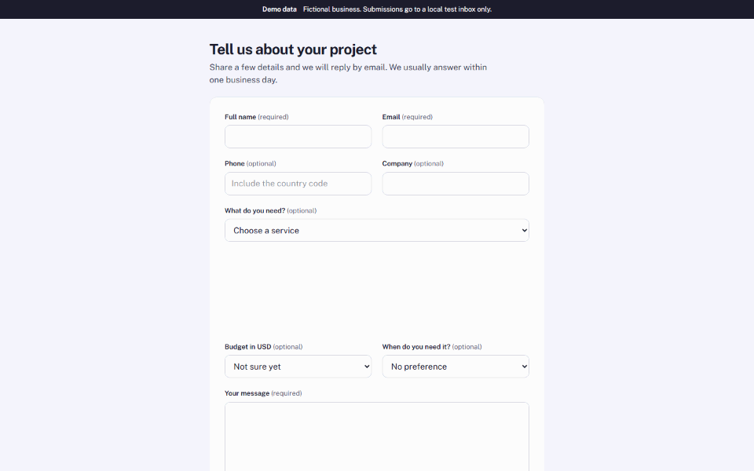
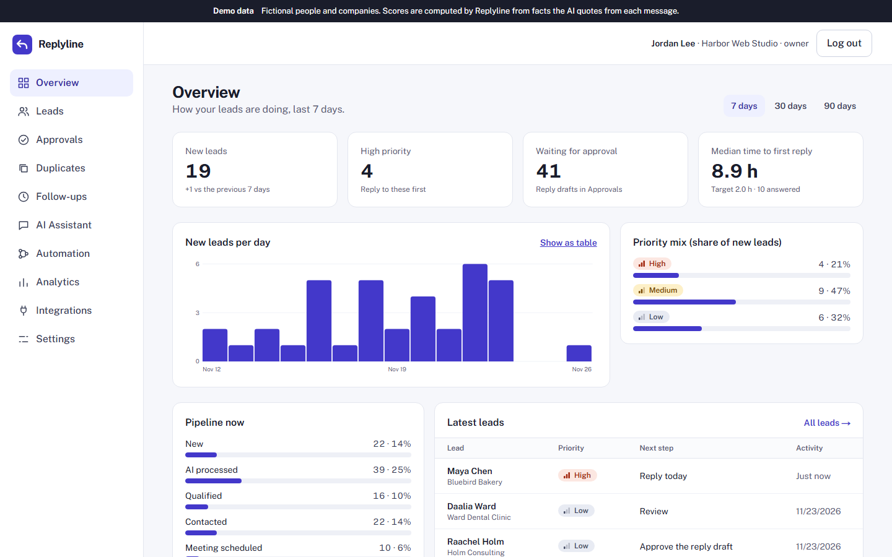
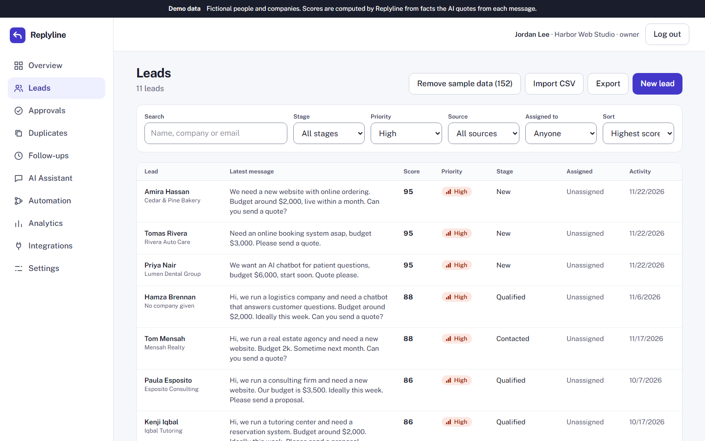
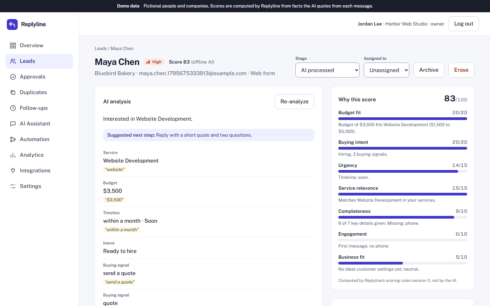
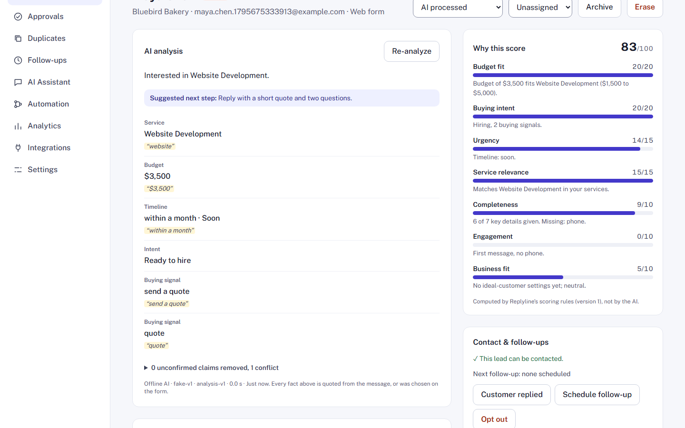
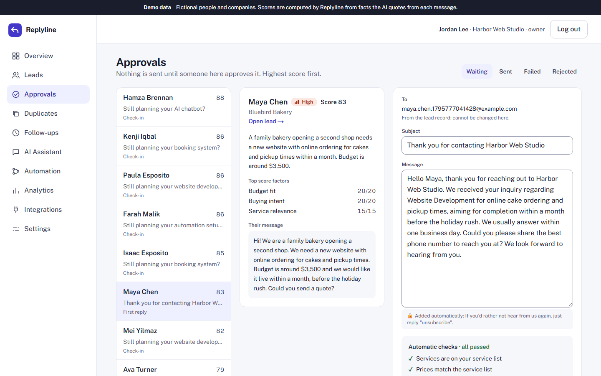
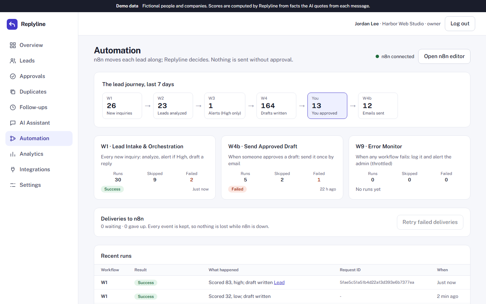
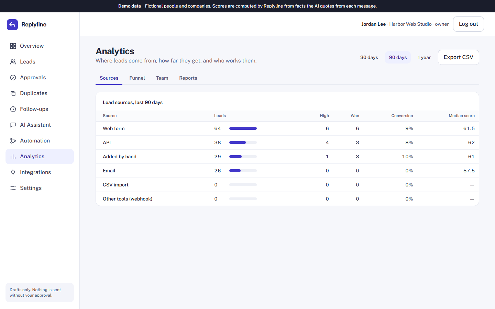
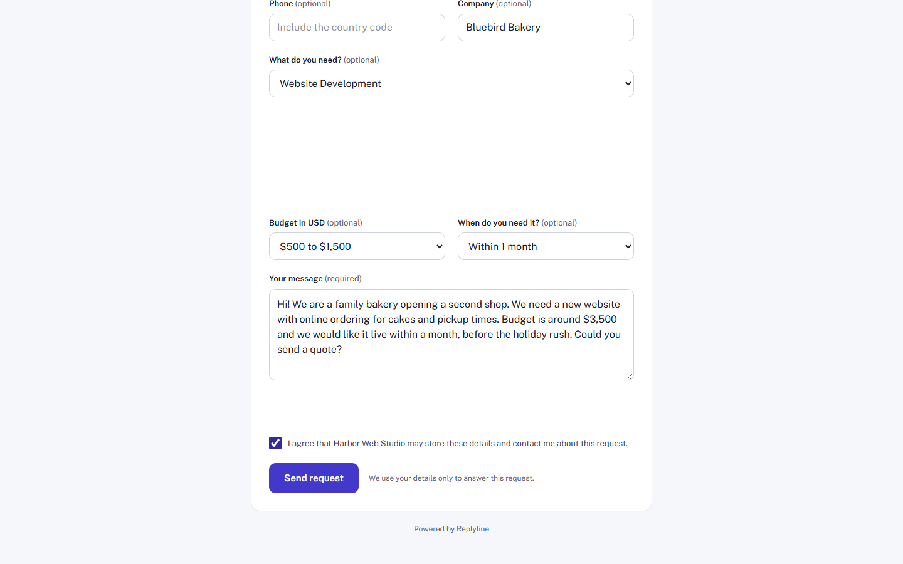

# Replyline

[](https://github.com/ZeeRiz99/N8N-Work-Flow/actions/workflows/ci.yml)

**AI lead management that sorts every inquiry, explains its score, and never sends a reply
without a person's approval.**



## The problem

Small service businesses get inquiries from forms, email and spreadsheets. Good leads get lost
among spam and price shoppers, replies go out late, and follow-ups depend on memory. "AI
auto-reply" tools answer fast but can invent prices or promises nobody approved.

## What it does

Replyline captures every inquiry, reads it with AI, scores it with transparent rules, alerts the
team, drafts the reply for human approval, and makes sure nobody is forgotten. n8n runs the
automation; the backend makes every decision; a person approves every outbound message.

## Project status and honesty

- A **self-developed portfolio project** (v1.0.0, all 12 phases complete). No customers, no
  revenue, no time-saving or conversion claims.
- **All data is fictional** (`@example.com` addresses, invented companies).
- AI accuracy numbers come only from committed evaluation reports, with the sample size stated:
  the live Gemini evaluation covers **14 scored cases**.
- The production setup is built and rehearsed locally but **not deployed on a public server**.
- Every public claim maps to evidence in [docs/PORTFOLIO_CLAIMS.md](docs/PORTFOLIO_CLAIMS.md).

## Architecture

```
Form / CSV / manual ─► FastAPI backend ──outbox──► n8n W1 ─► backend: analyze (Gemini + grounding + rules)
                         ▲   decides everything        │      ├─ High? alert the team
                         │                             │      └─ write reply draft ─► Approvals queue
                         └──── internal API ◄──────────┘                                 │ a person approves
                                                         n8n W4b ◄── draft.approved ◄────┘
                                                           └─► claim once ─► SMTP ─► sent + follow-up
```

Details: [docs/ARCHITECTURE.md](docs/ARCHITECTURE.md) · decisions: [docs/adr/](docs/adr/) ·
case study: [docs/CASE_STUDY.md](docs/CASE_STUDY.md).

## Tech stack

FastAPI (Python 3.14, SQLAlchemy 2, Alembic, Pydantic 2) · Next.js 16, React 19, TypeScript,
Tailwind 4 · PostgreSQL 18 · n8n 2 · Gemini (`gemini-3.6-flash`) · Docker Compose · Caddy ·
Mailpit · GitHub Actions · pytest · Playwright.

## Features (shipped)

- **Capture:** public web form (consent, honeypot, rate limit), manual entry, CSV import with
  preview; exact and fuzzy duplicate detection with human-only merge.
- **Understand:** Gemini extracts service, budget, timeline and intent, and **every fact must
  quote the customer's own words** (grounding); unquoted claims are dropped. Prompt-injection
  text is flagged for review and never raises a score.
- **Score:** deterministic, configurable 7-factor rules (versioned per organization) with a
  plain-language explanation per factor. The AI never sets the number.
- **Act:** high-priority alerts by email (Telegram optional), reply drafts with automatic checks (prices from your
  service list, no promised dates or discounts, link allow-list, opt-out line added by code), an
  **Approvals queue**, and sending only after a person approves, exactly once.
- **Keep going:** follow-ups after each sent email, check-ins on quiet leads, contact rules and a
  suppression list, a daily summary and source-performance report (numbers checked against SQL),
  analytics, team roles and invitations, an AI assistant grounded in your own records.
- **Reliable:** transactional outbox, idempotency keys, retries with backoff, circuit breaker,
  provisional scores when the AI is down, a sweeper for stalled work, throttled error alerts.

## Screenshots

| | |
|---|---|
|  |  |
|  |  |
|  |  |
|  |  |
|  | |

More: [docs/portfolio/](docs/portfolio/) (WebP copies in `final/`).

## Quick start (Windows, PowerShell)

Prerequisites: Git, Docker Desktop (WSL 2), Python 3.14, Node.js 24. If your path contains a
space, **quote every path**.

```powershell
git clone https://github.com/ZeeRiz99/N8N-Work-Flow.git "D:\Projects\N8N Work Flow"
cd "D:\Projects\N8N Work Flow"
powershell -NoProfile -ExecutionPolicy Bypass -File .\scripts\new-env.ps1   # .env with random secrets
.\scripts\dev.ps1 up                           # PostgreSQL, n8n, Mailpit

cd backend
python -m venv .venv
.\.venv\Scripts\python -m pip install -e ".[dev]"
.\.venv\Scripts\alembic upgrade head
.\.venv\Scripts\python -m uvicorn app.main:app --host 127.0.0.1 --port 8000 --timeout-keep-alive 65
# in a second terminal, still in backend:
.\.venv\Scripts\python -m app.cli seed-demo
.\.venv\Scripts\python -m app.cli set-demo-owner          # your login (password typed hidden)
cd ..
.\scripts\seed.ps1                             # ~150 fictional leads over 60 days
.\scripts\n8n-credentials.ps1
.\scripts\import-workflows.ps1 -Activate

cd frontend; npm ci; npm run build; npm run start
```

| Service | URL |
|---|---|
| Dashboard | http://localhost:3000 (public form: `/f/harbor-web`) |
| API docs | http://localhost:8000/docs |
| n8n editor | http://localhost:5678 |
| Mailpit inbox | http://localhost:8025 |

## Environment configuration

`scripts\new-env.ps1` writes `.env` from `.env.example` with random secrets (never committed).
The main switches:

| Variable | Meaning |
|---|---|
| `AI_PROVIDER` | `gemini` or `fake` (offline provider, same pipeline, no external calls) |
| `GEMINI_API_KEY` | Save it with `.\scripts\set-secret.ps1 GEMINI_API_KEY` (from the clipboard, never printed) |
| `GEMINI_DAILY_BUDGET` | Calls per day (default 18) to stay under the free-tier quota; past it, leads get a provisional score and are retried |
| `ALLOW_REGISTRATION` | Self-service sign-up on or off |
| `SMTP_*`, `ALERT_EMAIL_TO` | Mailpit in development; a real SMTP service in production |

Use synthetic data only with a free-tier Gemini key. Production settings:
[.env.production.example](.env.production.example).

## API

OpenAPI at `/docs` (development only). Curated guide: [docs/API_DOCUMENTATION.md](docs/API_DOCUMENTATION.md).

## n8n workflows

Nine workflows (W1 intake, W4b send, W5 follow-ups, W6 quiet-lead check-ins, W7 duplicate scan,
W8 daily summary, W9 error monitor, W9b retry sweeper, W10 source performance):
[docs/AUTOMATION_WORKFLOWS.md](docs/AUTOMATION_WORKFLOWS.md).

## Testing

361 backend tests, 4 Playwright suites, journey, smoke, failure-injection, load and restore
scripts: [docs/TESTING.md](docs/TESTING.md).

**AI evaluation:** [`evals/reports/2026-11-23-gemini-sample15.md`](evals/reports/2026-11-23-gemini-sample15.md),
a live Gemini run on 14 scored fictional inquiries (stratified sample of a 40-case dataset):
priority band agreement 93%, service and budget extraction 100%, grounding rejected 1 of 62
claims, no schema-invalid output. A small sample: one case moves a percentage by about 7 points.

## Deployment

`infra/compose.prod.yml` runs PostgreSQL, n8n, the backend, the frontend and Caddy (automatic
HTTPS; only Caddy is public, n8n's editor only through an SSH tunnel). On a server: fill
`.env.production`, then `./scripts/deploy.sh`. Runbook: [docs/DEPLOYMENT.md](docs/DEPLOYMENT.md).

## Roadmap

Public deployment · Google Sheets "lite" variant · nonce-based CSP · full 40-case live evaluation · screen-reader
pass. Open items: [docs/BACKLOG.md](docs/BACKLOG.md).

## Documentation

[Architecture](docs/ARCHITECTURE.md) · [Database](docs/DATABASE_SCHEMA.md) ·
[API](docs/API_DOCUMENTATION.md) · [Workflows](docs/AUTOMATION_WORKFLOWS.md) ·
[Security](docs/SECURITY.md) · [Testing](docs/TESTING.md) · [Deployment](docs/DEPLOYMENT.md) ·
[UI action audit](docs/UI_ACTION_AUDIT.md) · [Performance](docs/PERFORMANCE.md) ·
[Demo script](docs/DEMO_SCRIPT.md) · [Video script](docs/DEMO_VIDEO_SCRIPT.md) ·
[Case study](docs/CASE_STUDY.md) · [Claims and evidence](docs/PORTFOLIO_CLAIMS.md) ·
[Client delivery kit](docs/CLIENT_DELIVERY_KIT.md) · [Decisions](docs/adr/) ·
[Development log](docs/DEVELOPMENT_LOG.md)

## License

All rights reserved until the licence is decided (see master prompt §16.7). The repository is
private.
