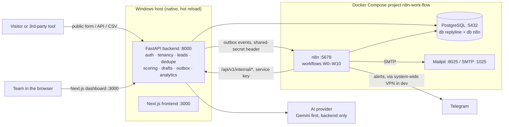
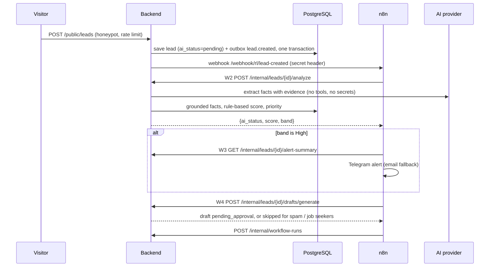
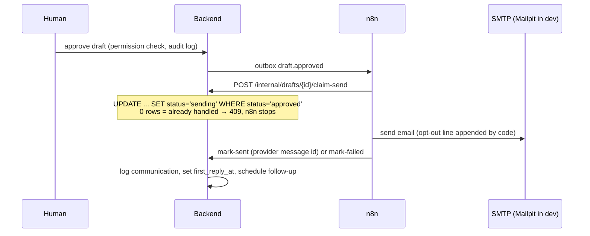

# Replyline architecture

Status: Phase 1 draft for approval. Detailed rules live in `docs/MASTER_PROMPT.md` §5, §8 and §9; this file is the overview a new reader starts with.

## 1. The idea in one line

The **backend decides, n8n carries it out, a human approves every outbound message.** AI only extracts facts with evidence; fixed rules compute the score.

## 2. Components



n8n uses its **own** database and role; it never reads or writes the app tables. In production only the backend is public; the n8n editor stays private.

## 3. Who owns what

| Concern | Backend | n8n |
|---|---|---|
| Validation, normalization, dedupe, persistence | Yes | No |
| AI calls, prompts, schemas, grounding | Yes | No |
| Scoring rules, thresholds, alert throttling, "who is due now" | Yes | No |
| Draft and approval state machine | Yes | No |
| Sequencing, branching, scheduling triggers | No | Yes |
| Telegram and SMTP delivery (credentials live in n8n) | No | Yes |
| Retry state and idempotency | Yes | Timing and alerts only |

## 4. Core flows

### F1: new lead



### F3: approval and send



**F2** (third-party inbound) maps fields in n8n and calls `/internal/leads/ingest`; the backend then emits `lead.created`, which re-enters F1.
**F4** (schedules): hourly n8n triggers call `/internal/...`; the backend returns only the organizations due in their own timezone.
**F5** (failure): W9 logs the failed run; the backend answers `should_alert` (throttled); the sweeper retries pending outbox events and failed AI runs, at most 3 times.

## 5. Reliability patterns

Idempotency key on every mutating internal call and inbound lead · transactional outbox with redispatch · atomic send claim · bounded retries (3, exponential backoff, idempotent calls only) · `X-Request-ID` from browser to backend to n8n and back · graceful AI failure (lead saved, provisional rule-based score, retried later).

## 6. Networking (dev)

| From → To | URL |
|---|---|
| Browser → dashboard / API docs / n8n / Mailpit | `localhost:3000` / `localhost:8000/docs` / `localhost:5678` / `localhost:8025` |
| n8n container → native backend | `http://host.docker.internal:8000` |
| Native backend → n8n webhooks | `http://localhost:5678/webhook/rl/...` |
| n8n container → Mailpit | `mailpit:1025` |
| Backend → PostgreSQL | `localhost:5432` |

Separate env vars: `BACKEND_URL_FOR_N8N`, `N8N_WEBHOOK_BASE_URL`, `N8N_PUBLIC_URL`.

## 7. Repository layout (target)

```
N8N Work Flow/            repo root (GitHub: N8N-Work-Flow)
  CLAUDE.md  README.md  .env.example  .gitignore  .gitattributes  .editorconfig
  .claude/settings.json
  docs/       MASTER_PROMPT.md, this file, schema, API, security, ADRs, design/
  backend/    app/{core,api/v1,models,schemas,services,repositories,integrations,ai,scoring,security,utils}
              migrations/  tests/  pyproject.toml
  frontend/   src/{app,components,features,lib,hooks}  tests/  e2e/
  n8n/        workflows/*.json (no secrets)  README.md
  contracts/  internal-api/*.json
  evals/      datasets/  reports/  run_eval.py
  infra/      compose.dev.yml  compose.prod.yml  postgres-init/
  scripts/    inspect-env.ps1 dev.ps1 seed.ps1 smoke.ps1 import-workflows.ps1 export-workflows.ps1 backup-db.ps1
  .github/workflows/ci.yml
```

## 8. Decisions behind this

Locked Decisions D1–D24 (master prompt §4) and ADRs 001–010 in `docs/adr/`.
