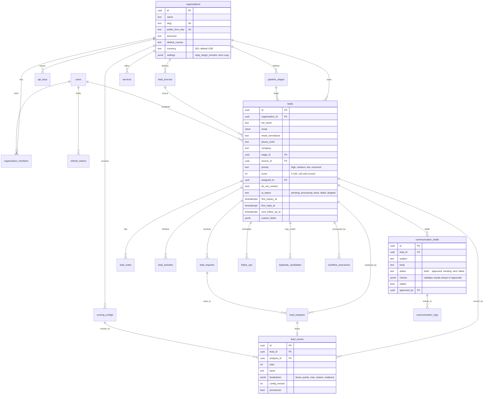

# Replyline database schema

Status: **Approved design (Phase 1 gate, 2026-11-21).** Column-level details are still settled per phase in migrations; any change to the approved structure is a C3 stop-and-ask item. Tables arrive through Alembic migrations in the phase that first needs them.
Source of truth for column lists: `docs/MASTER_PROMPT.md` §6 (v3).

## Conventions

- `id uuid` primary key, default `gen_random_uuid()`.
- `organization_id uuid not null` (foreign key) on **every tenant table**; every repository method requires it.
- `created_at`, `updated_at` as `timestamptz`, stored in UTC. Soft delete with `archived_at`.
- snake_case names; Alembic naming conventions for constraints.
- Extensions: `citext` (emails), `pg_trgm` (search), `pgcrypto` if needed for `gen_random_uuid()`.
- Money as integer minor units plus an ISO currency code (ADR 006).
- Two databases on one server: `replyline` (role `replyline_app`) and `n8n` (role `n8n_app`). Neither role can touch the other database.

## Core relationships

The diagram shows only the key columns of the busiest tables. The infrastructure tables below have no foreign-key fan-out worth drawing.

## All tables by phase

| Phase | Tables | Notes |
|---|---|---|
| **P3** walking skeleton | `organizations`, `users`, `leads`, `lead_inquiries`, `api_keys`, `idempotency_keys`, `outbox_events`, `workflow_executions` | Minimal columns; temporary dev auth |
| **P4** CRM core | `organization_members`, `refresh_tokens`, `pipeline_stages`, `lead_sources`, `services`, `lead_notes`, `lead_activities`, `duplicate_candidates`, `audit_logs` | Full `leads` columns |
| **P5** AI | `lead_analyses`, `scoring_configs`, `lead_scores` | Facts with `evidence` and `source` (`message` or `form`) |
| **P6** automation | `communication_drafts` (with `checks`), `communication_logs`, `follow_ups` (basic), `automation_workflows`, `notifications`, `integrations` | |
| **P8** | `suppressions`, full `follow_ups` rules | |
| **P9** | `report_snapshots` | |

## Changes versus master prompt v2 (for approval)

1. `organizations.currency` (ADR 006).
2. `organizations.settings.reply_target_minutes` and the form's response-time line (ADR 009).
3. `leads.first_reply_at` for the median reply-time metric (ADR 009).
4. `communication_drafts.checks jsonb`: stored validator results (ADR 010).
5. Extracted facts carry `source: "message" | "form"` inside `lead_analyses.extracted` (ADR 010).
6. Budget comparison status `compared | not_compared` inside the score breakdown (ADR 006).

## Key constraints and indexes

- Partial unique `(organization_id, email_normalized)` where not null and `archived_at is null`.
- Unique `(organization_id, scope, key)` on `idempotency_keys`; unique `(workflow_key, n8n_execution_id)` on `workflow_executions`.
- Unique `(organization_id, user_id)` on `organization_members`; unique per organization + channel + address on `suppressions`.
- Indexes: `(organization_id, stage_id)`, `(organization_id, priority, created_at desc)`, `(organization_id, next_follow_up_at)`, `(organization_id, email_normalized)`, trigram GIN on name / company / email, `(lead_id, created_at desc)` on activities, `(status, next_attempt_at)` on outbox.
- Optional P10 hardening: PostgreSQL row-level security as a second wall behind the repository checks.

## Open questions for the developer

- None blocking. Retention defaults (how long to keep leads and execution data) are set in P9 settings.
